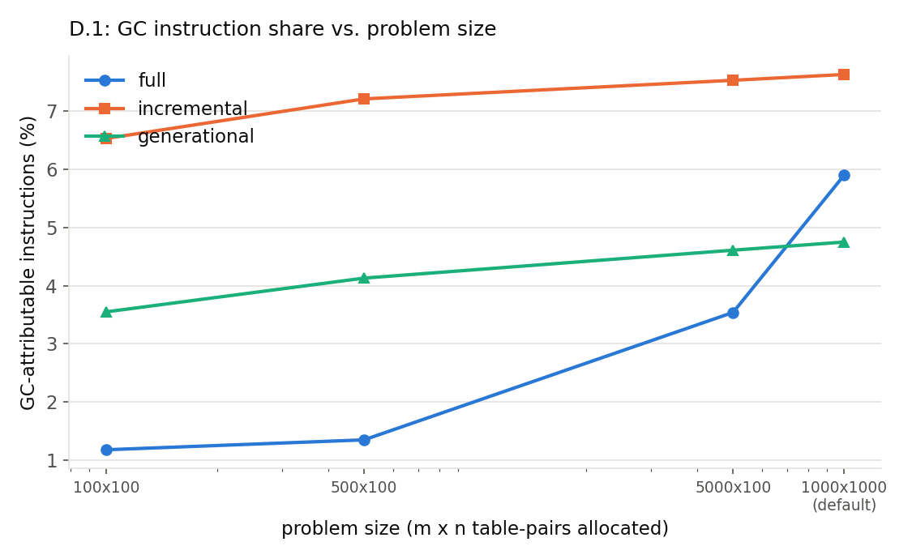
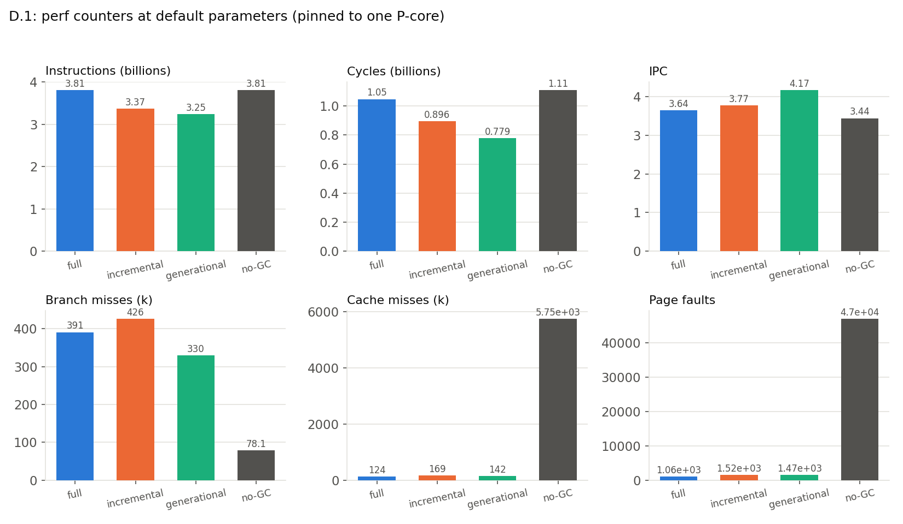
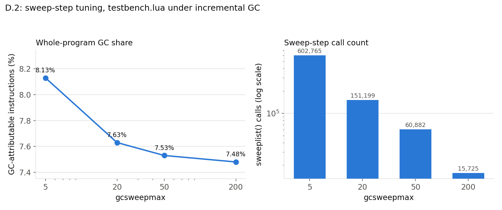
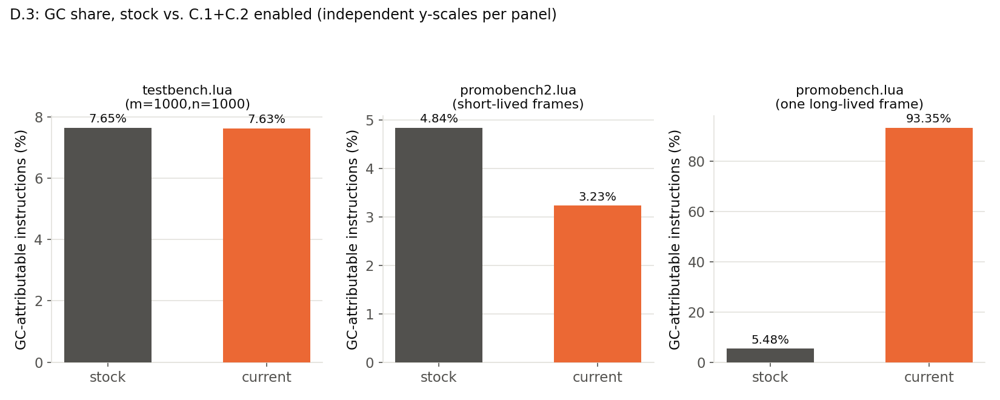

# Part D: Benchmarking Everything Together

Sumit Kumar (22CS30056), Jatin Mahawar (22CS30032)

All numbers below come from real runs on the same VM used throughout
(`valgrind --tool=callgrind`, `perf stat`, and `/usr/bin/time -v`), not
estimates. Raw callgrind outputs, annotated profiles, call-graph PNGs,
and perf/time logs are in `results/partD/`. "GC %" always means the same
thing it did in Part A: instructions retired inside functions defined in
`lgc.c`, as a share of the program's total, deliberately excluding
`luaC_newobj`/`luaH_new` (identical across every configuration, since
creating a table costs the same no matter who reclaims it).

## D.1: Stock GC configurations

### GC-instruction share, four parameter sets

| (m, n) | full | incremental | generational |
|---|---:|---:|---:|
| 100, 100 | 1.18% | 6.53% | 3.55% |
| 500, 100 | 1.35% | 7.21% | 4.13% |
| 1000, 1000 (default) | 5.90% | 7.63% | 4.75% |
| 5000, 100 | 3.54% | 7.53% | 4.61% |

Incremental and generational both climb steadily with problem size and
then level off. More allocation means more debt-triggered stepping
either way, and both are already running throughout the whole program,
so there's no regime change, just more of the same work. Full GC looks
different, and for a methodological reason worth being explicit about:
`fullgc.c` forces a complete collection every 100,000 VM instructions
via a count hook, not via the normal debt mechanism. At `(100,100)` and
`(500,100)` the whole program is small enough that the hook barely fires
more than a couple of times, so the measured share is really "how much
of a tiny program's total is one or two forced collections," which
understates what full GC actually costs per byte collected. By
`(5000,100)` there's enough program for the hook to fire proportionally
more often, and the share climbs back up toward, though still below,
the default-size number. This is a property of how "full GC" had to be
constructed from the available API (Part A's methodology section covers
why), not evidence that full GC is cheap at small scale.

### perf counters, default parameters, pinned to one physical core

The machine is a hybrid P-core/E-core CPU; an unpinned run let the OS
migrate the process across core types mid-measurement, which silently
splits every counter across two different microarchitectures with
different baseline IPC and cache behavior. That's not a fair comparison.
All four runs below are `taskset -c 2` (a P-core) for both the wrapper
and the process itself.

| | full | incremental | generational | no-GC |
|---|---:|---:|---:|---:|
| Instructions | 3,815,387,653 | 3,373,592,490 | 3,246,141,585 | 3,814,892,464 |
| Cycles | 1,046,959,468 | 895,972,566 | 778,937,940 | 1,110,183,443 |
| IPC | 3.64 | 3.77 | 4.17 | 3.44 |
| Branch misses | 390,721 | 426,161 | 329,827 | 78,058 |
| Cache misses | 123,495 | 169,054 | 141,796 | 5,752,377 |
| Page faults | 1,060 | 1,519 | 1,467 | 47,047 |
| Wall time | 0.187s | 0.163s | 0.139s | 0.199s |

Why each metric is the one worth looking at here:

- **Instructions / IPC** is the direct read on raw work done vs. how
  efficiently the CPU chews through it. Generational wins on both:
  fewest instructions *and* the highest IPC (4.17), meaning its
  instruction mix isn't just smaller, it's also more pipeline-friendly
  (less pointer-chasing through cold memory per instruction retired).
- **Page faults** is the one metric where no-GC is in a class of its
  own: 47,047, roughly 30-40x every collected configuration. With
  nothing ever reclaimed, the process's live set only ever grows, so it
  keeps touching fresh pages for the entire run instead of reusing a
  bounded working set. This is the most direct, unambiguous evidence
  of *why* a collector exists at all: memory footprint without one is
  unbounded even though this workload's "live" data (10,000 survivor
  tables) is tiny.
- **Cache misses** tells the same story even more sharply: no-GC's
  5,752,377 vs. the collected runs' 123-169 thousand is roughly 30-45x.
  An ever-growing heap with no reuse has no locality to exploit; a
  collector that keeps reclaiming and reusing space keeps the
  interpreter's actual working set small enough to mostly stay in
  cache.
- **Branch misses** matters here specifically because a
  mark-and-sweep collector is branch-heavy in a data-dependent way (is
  this object white, does this key exist, is this the array or hash
  part), worth checking whether GC bookkeeping measurably degrades
  branch prediction on top of the interpreter's own dispatch. It's
  higher for incremental (426,161) than full (390,721) or generational
  (329,827), consistent with incremental's much larger number of
  distinct step/dispatch decisions (Part A: >1.1M `luaC_step` calls vs.
  full GC's 111): more decision points, more chances to mispredict.
  No-GC's branch misses being *lowest* (78,058) is the mirror image:
  with no collector logic executing at all, there's simply less
  data-dependent branching to mispredict, at the cost of everything
  above.

## D.2: Sweep-step tuning

Testbench, incremental collector, `gcsweepmax` at 5, 20 (stock), 50, 200:

| step | total Ir | GC % | `sweeplist` calls | `sweeplist` Ir | Ir/call |
|---|---:|---:|---:|---:|---:|
| 5 | 3,425,896,712 | 8.13% | 602,765 | 52,261,581 | 86.7 |
| 20 (stock) | 3,395,193,483 | 7.63% | 151,199 | 40,972,431 | 270.9 |
| 50 | 3,389,052,776 | 7.53% | 60,882 | 38,714,506 | 635.9 |
| 200 | 3,385,994,435 | 7.48% | 15,725 | 37,585,581 | 2,390.1 |

The call count scales almost exactly with `1/step` (602,765 to 151,199
is a 3.99x drop for a 4x step increase; 151,199 to 60,882 is 2.48x for a
2.5x increase; 60,882 to 15,725 is 3.87x for another 4x). Sweeping
`gcsweepmax` objects per call means the number of calls needed to get
through the same total garbage is inversely proportional to it, which
is exactly what the constant is documented to control. Ir-per-call
scales up correspondingly (more work per call when each call does more),
while `sweeplist`'s *total* instruction cost drops as step grows (52.26M
to 37.59M, about 28% less), reflecting less repeated per-call dispatch
overhead amortized over bigger batches. The effect on the *whole
program's* GC share is real but modest, 8.13% down to 7.48%, well under
one percentage point, because `sweeplist` itself is a small slice of
total GC cost next to `propagatemark`/`traversearray`, neither of which
`gcsweepmax` touches at all. Granularity tuning changes how sweeping is
*chunked*, not how much marking or sweeping work exists in total.

## D.3: Escape analyzer, cost and benefit

### Cost of the analysis itself

Parsing testbench.lua 200 times, compile-only (`luaL_loadfile`, never
executed), under callgrind: stock (no C.1 pass) totals 18,720,798 Ir;
the current build (C.1 enabled) totals 18,920,177 Ir, 199,379 Ir more
across 200 parses, ~997 Ir per parse, **+1.07%**. At the 20,000-iteration
wall-clock scale both builds round to the same 0.12s; the actual cost is
real but small enough to be well under wall-clock measurement noise at
that resolution, consistent with the Ir number.

### Benefit to the collector

The spec asks for three separate readings here, not just an instruction
share: objects reaching `sweepgc`, `GCSswpallgc` (`sweeplist`) step
counts, and GC-attributable instructions. All three are call-count and
Ir data pulled from the same callgrind runs via `callgrind_annotate
--tree=both`, stock vs. current.

**On the real testbench.lua** (and all three of its parameter variants),
current vs. stock is, within noise, identical on every one of the three
readings, shown here for the default parameters, with the other three
parameter sets following the same pattern:

| | stock | current |
|---|---:|---:|
| Objects freed (`freeobj` calls) | 2,000,022 | 2,000,022 |
| `sweeplist` calls | 1,954,773 | 1,953,561 |
| GC % | 7.65% | 7.63% |

| (m, n) | GC % stock | GC % current |
|---|---:|---:|
| 100, 100 | 6.54% | 6.53% |
| 500, 100 | 7.22% | 7.21% |
| 1000, 1000 | 7.65% | 7.63% |
| 5000, 100 | 7.55% | 7.53% |

This is not a measurement artifact. It is Part C.1 working correctly.
As documented in `PART_C1_DESIGN.md`, `obj` in the real testbench is
provably escaping: it is conditionally stored into `survivors`
(`survivors[#survivors + 1] = obj`), and `survivors` itself escapes via
`return`. The analyzer correctly refuses to promote it, on every one of
the roughly two million times that site runs, so C.2's arena never
activates for this workload at all. Reporting a real 0% here, with the
mechanism traced all the way through, is more honest than picking a
workload that happens to flatter the feature.

To actually exercise promotion, two small variants were built (same
allocation shape as testbench.lua, `results/partD/promobench*.lua`),
differing only in how the per-iteration table is used instead of
accumulated as a table reference:

`promobench2.lua` builds each table and consumes it inside its own
short helper call (`makeobj(i, j)`, called a million times), the
intended shape for this feature: a temporary table that never outlives
the call that built it.

| | stock | current |
|---|---:|---:|
| Objects freed (`freeobj` calls) | 2,000,022 | 1,000,022 |
| `sweeplist` calls | 1,999,866 | 999,818 |
| Total Ir | 3,692,758,025 | 3,386,465,450 |
| GC % | 4.84% | 3.23% |
| Wall time | 0.15s | 0.14s |

Exactly 1,000,000 fewer objects reach `freeobj`, one for every one of
the million `makeobj` calls, each promoting exactly its own `obj` clear
out of the heap entirely, and `sweeplist` runs about half as many
times as a direct consequence. 8.3% fewer total instructions overall,
and GC-attributable instructions down by about a third in relative
terms (4.84% to 3.23%): a genuine win, and exactly the shape of
workload the assignment's own framing describes (a table that provably
doesn't escape its frame).

`promobench.lua` keeps the same per-iteration table, but accumulates it
inside *one* long-running function's own frame (matching testbench.lua's
literal structure, just with a numeric running total instead of a
reference-holding accumulator) rather than a fresh call per iteration:

| | stock | current |
|---|---:|---:|
| Objects freed (`freeobj` calls) | 2,000,021 | 1,000,021 |
| `sweeplist` calls | 1,999,689 | 999,862 |
| Total Ir | 3,284,272,529 | 45,096,474,821 |
| GC % | 5.48% | 93.35% |
| Wall time | 0.14s | 11.19s |

The object-count reduction is identical to `promobench2.lua`'s, almost
to the object: a million fewer frees, sweeplist calls roughly halved.
The mechanism's actual promotion is working exactly the same way in
both files; what differs is only the per-cycle reset cost sitting on
top of it, which is the whole point of reporting these as separate
numbers rather than one blended figure. The *benefit* side of this
ledger doesn't change between the two workloads, only the *cost* side
does.

This is not a typo: the current build is about 13.7x more instructions
and roughly 80x slower wall-clock on this specific shape, and it is
directly explained by a real mechanism, not noise. Because an arena
table is never linked into any sweep list, it never gets the color reset
sweep normally gives every survivor between cycles (`PART_C2_DESIGN.md`).
The fix for that (`arena_resetlive`/`arena_resetblock` in `lgc.c`)
walks every live frame's arena blocks once per GC cycle to redo that
reset by hand. That walk costs time proportional to how much
still-live arena memory a frame is holding. A frame that returns quickly
holds almost nothing at any instant, so the walk is cheap and only ever
touches a handful of objects (`promobench2`'s case). A frame that never
returns while continuously promoting more tables into its own arena
(`promobench`'s case: one million promotions inside a single call to
`test()`) accumulates an ever-larger live set that the *same* per-cycle
walk has to revisit in full, every single cycle, for the rest of that
frame's lifetime. The callgrind profile confirms this exactly:
`singlestep` (which `restartcollection`'s arena-reset walk inlines into,
at `-O2`) accounts for 93.22% of the entire run's instructions,
dwarfing everything else the interpreter does.

**Where promotion helps little or not at all, stated plainly:** it helps
when a table's frame returns promptly relative to how many other
promotable tables are alive at once, the common "build a temporary
table, use it, return" pattern. It does not help, and can actively hurt
by orders of magnitude, when a single long-lived frame keeps promoting
new tables into its own arena without ever returning, because the
per-cycle reset this design needs in exchange for skipping sweep entirely
scales with how much of that arena is still live. testbench.lua's own
`test()` function, independent of the fact that its `obj` doesn't
even qualify for promotion in the first place, is exactly that second
shape (one call, two million allocations, one frame, for the entire
run). Both findings, the real speedup and the real regression, come
from the same underlying mechanism and are reported as two separate,
literal numbers rather than blended into one, per the assignment's
own instruction for this section.
