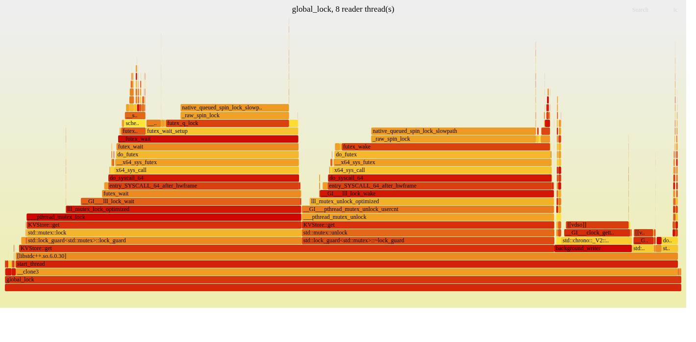
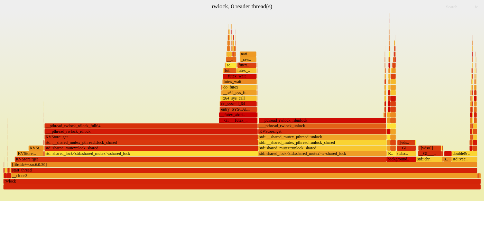

## 1. What we built

`kvstore.cpp` and `kvstore.h` hold an open-addressing hash table with linear probing. Each key gets one 64-byte, cache-line-aligned slot: 8 bytes of key, 8 bytes of length and state, and 48 bytes for the value. Values up to 48 bytes (a `Trade` is 32, an `Instrument` is 20) sit inside the slot, and anything larger spills to a heap buffer. Deletion shifts later entries of the probe chain backwards, so there are no tombstones. The table doubles when it is half full. `kvstore_test.cpp` checks insert, lookup, overwrite, erase, a 500-byte spilled value, growth to 200k keys and erase with many collisions.

We picked this layout by measuring three tables single-threaded (`bench/table_bench.cpp`, 20M gets, pinned core): chaining with one node per key, open addressing with a pointer to a heap value, and the inline slot. The workload is almost all reads, so get latency decided it.

| table | get, 100k keys | get, 1M keys | insert, 1M keys |
|---|---|---|---|
| chained | 11.0 ns | 44.1 ns | 80 ns |
| open + heap pointer | 9.4 ns | 50.2 ns | 95 ns |
| open + inline slot | 8.9 ns | 35.7 ns | 136 ns |

**The inline slot wins gets at both sizes.** It costs more to insert (larger slots, bigger memset on growth) but a hit touches a single cache line, which is what the readers do all day.

The three drivers use the same `kvstore.cpp`. Synchronisation is a compile-time choice (`-DNOVA_SYNC=0|1|2`): nothing, one `std::mutex` around every `put` and `get`, or a `std::shared_mutex` (shared for `get`, unique for `put`). Only the guard type changes. `workload_run` loads all the data before it starts the readers, so it never has a writer running during the read phase. The drivers therefore start their own background writer that waits for the load to finish and then overwrites random existing trades at 50,000 puts per second until the readers stop. `single_thread` has no writer and one reader.

There is no durability in this store or in Parts B to D. If the process dies, the data is gone.

## 2. Results and where the lock versions lose time

All runs are on an i9-13900K, pinned to CPUs 0 to 15 (the 8 performance cores with hyperthreads), 5 s of reads, mean of 3 runs. `single_thread` does 19.4M reads/s with one reader. The server's CPU governor was set to `performance` for all runs (it made no difference to the global lock and lifted the rwlock by about 7%).

| readers | global_lock rps | p99 / p999 (us) | rwlock rps | p99 / p999 (us) |
|---|---|---|---|---|
| 1 | 16.7M | 0.1 / 0.3 | 16.7M | 0.1 / 0.3 |
| 2 | 12.0M | 0.6 / 1.9 | 19.2M | 0.2 / 1.1 |
| 4 | 11.1M | 2.3 / 3.5 | 18.0M | 0.7 / 3.2 |
| 8 | 9.2M | 5.0 / 7.7 | 18.1M | 3.8 / 5.0 |

**The global lock never scales:** one reader is already its best, and 8 readers deliver 55% of that. **The rwlock stops scaling at 2 readers** (19.2M) and stays flat at about 18M from 4 to 8 readers. Both are far above the 100,000 reads/s target in absolute terms. **Neither lock turns extra cores into extra throughput.**

We used `perf stat` attached to the running process for a 3 s window in the middle of the read phase (so the load and the final latency sort stay out of the counters) and `perf record` with DWARF unwinding on the same window. Kernel symbols needed `kptr_restrict=0` during these runs.

| config | CPUs busy | IPC | L1 misses / 1k instr | ctx switches / s |
|---|---|---|---|---|
| global_lock r1 | 2.0 | 1.66 | 1.9 | 1.5k |
| global_lock r8 | 8.3 | 0.57 | 4.5 | 447k |
| rwlock r1 | 2.0 | 1.66 | 1.8 | 3.0k |
| rwlock r8 | 6.9 | 0.38 | 7.0 | 446k |

Samples grouped by the function they land in (leaf frame):

| config | kernel lock wait | lock code in user space | clock reads | table lookup |
|---|---|---|---|---|
| global_lock r1 | 0.4% | 6.2% | 66.2% | 6.0% |
| global_lock r4 | 14.0% | 28.3% | 31.4% | 2.1% |
| global_lock r8 | 56.3% | 10.8% | 14.9% | 1.1% |
| rwlock r4 | 2.4% | 46.7% | 27.2% | 6.3% |
| rwlock r8 | 5.8% | 63.6% | 10.6% | 6.1% |

{width=49%} {width=49%}

*Flame graphs at 8 readers: global_lock (left), rwlock (right). The other six are in `results/profile/`.*

**The two locks lose time for different reasons.** In `global_lock` the dominant cost is **waiting for the lock**. At 8 readers **56% of the samples are in the kernel's futex path** (`native_queued_spin_lock_slowpath`, `futex_wait`, `futex_wake`, `lll_lock_wait`), with 447k context switches per second. Threads really sleep and wake up. The flame graph shows the same thing as two tall towers rising out of `std::mutex::lock` and `unlock`. In `rwlock` almost nothing sleeps: only 5.8% of samples are in the kernel. Instead **64% of the time is inside** `pthread_rwlock_rdlock` and `rdunlock`, which are user-space atomic increments and decrements on one reader counter. That counter lives in one cache line that every core has to take from every other core on each call. We can see this in the counters: IPC drops from 1.66 to 0.38 and L1 misses per thousand instructions go from 1.8 to 7.0, while the last-level cache miss rate stays flat at about 0.03 per thousand instructions. The lines move between cores' private caches and never go to memory. **So for the rwlock the loss is cache-line bouncing, and for the plain mutex it is lock acquisition (waiting).** The headline `cache-miss %` is misleading here because its denominator, cache references, grows with the thread count, which is why we report misses per instruction.

A caveat on reading the flame graphs: 11% to 66% of samples are in `clock_gettime` (vdso) and the latency vector, because the generator times every call. That overhead is the same for every store we build, but it does mean the lock share above understates how much of the *store's own* time the lock takes.

## 3. Design note: record layout

**The workload.** Readers do point gets of a whole `Trade` row (32 bytes: id, symbol, price, timestamp), mostly on a hot 1% of keys, and `get()` copies the full value out. The join in Part C probes by `symbol`, but then fetches the whole inner row with `get()`. Nothing in the workload scans one column across many rows, and the writer replaces whole rows.

**The options.** NSM stores each row contiguously, so a get touches one cache line (two rows fit in a line). DSM puts each field in its own array, so a whole-row get touches up to four lines in four arrays, and a table update has to write to four places. PAX keeps rows together in a page but stores the page column-major, so a whole-row get touches up to four lines inside one page, and in exchange a scan of one field stays dense within the page.

**What we measured.** `bench/layout_bench.cpp` builds the same `Trade` table in NSM, DSM and PAX (16, 64 and 256 rows per page) and measures three access patterns. A random whole-row get chains each lookup to the previous result, so it times latency, not something prefetching hides. A symbol-only get models the join probe. A full scan sums `price`. It also runs 8 threads of whole-row gets. We did this at 100k rows (3.2 MB, the real workload size, sits in the L3) and 4M rows (128 MB, out of cache). Three runs, medians, with run-to-run spread within about 15% apart from DSM's 4M symbol-only number (38 to 61 ns, because it depends on how well the 32 MB symbol array stays cached).

| | rows | NSM | DSM | PAX-64 |
|---|---|---|---|---|
| whole-row get (ns) | 100k | **15.7** | 18.6 | 17.5 |
| | 4M | **116** | 150 | 140 |
| symbol-only get (ns) | 100k | 13.4 | **8.8** | 14.6 |
| | 4M | 114 | **38 to 61** | 111 |
| price scan (ns/row) | 100k | 0.44 | **0.37** | 0.49 |
| | 4M | 1.95 | **0.54** | 1.92 |
| 8-thread whole-row get (Mops/s) | 100k | **480** | 387 | 398 |
| | 4M | **72** | 55 | 55 |

**Decision: NSM (row-major).** The operation that matters, a whole-row point get, takes 15% to 25% less time in NSM at both sizes, and 8 threads get 20% to 30% more throughput from it. The reason is the number of cache lines per get: one for NSM against four for DSM or PAX. DSM would win a column scan by 3.6x at 4M rows and a symbol-only probe by 1.5x to 3x, but the assignment's workload does neither of those on the hot path. PAX never won a pattern outright. Its whole-row get is slower than NSM and its scan is no better than NSM until the page is large, so it pays for the complexity of two layouts without covering either case well.

There is one more reason that is specific to this project. `put` takes an opaque byte range and the store knows no schema, and Part B will publish a new version by copying a small unit. Copying a row (or a bucket of rows) is one memcpy in NSM. In DSM or PAX a version would have to copy or patch several arrays. NSM is also the layout that the inline-slot table in section 1 already uses.

The case where we would change our mind is an analytics workload that scans one field across the whole table. Then DSM, or PAX with large pages, is the right answer, and the numbers above show by how much.

## 4. Files

`kvstore.{h,cpp}`, `kvstore_test.cpp`, `single_thread.cpp`, `global_lock.cpp`, `rwlock.cpp`, `Makefile` (build and test: `make test`), `profile.sh` and `scaling.sh` (the scripts that produced `results/`), `bench/table_bench.cpp`, `bench/layout_bench.cpp`. Raw data: `results/scaling.txt`, `results/layout_bench.txt`, and in `results/profile/` the perf stat output, folded stacks, SVG and PNG flame graph for each of the 8 configurations.
