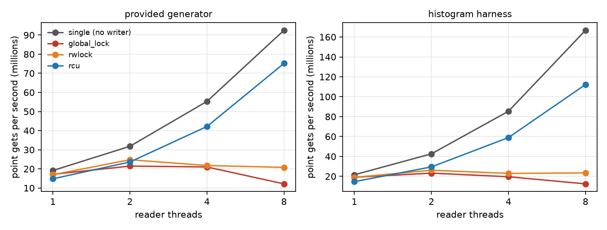
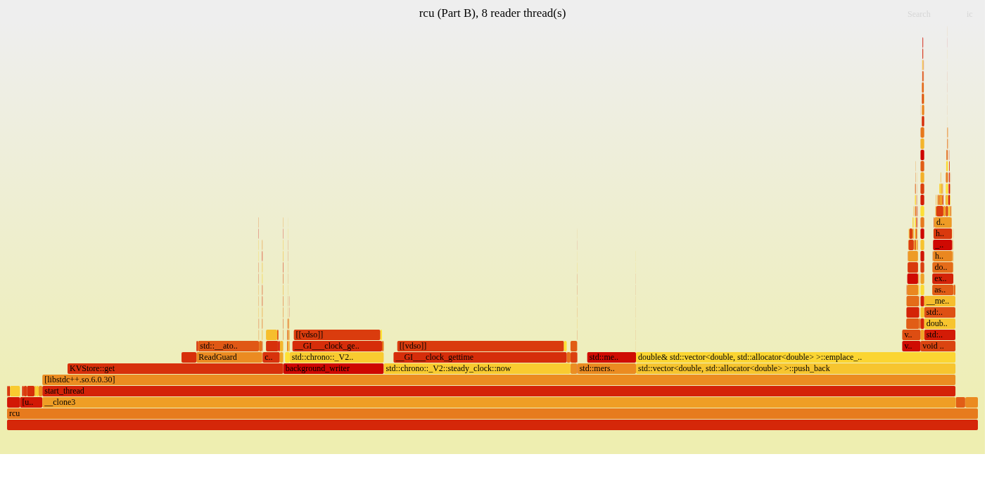
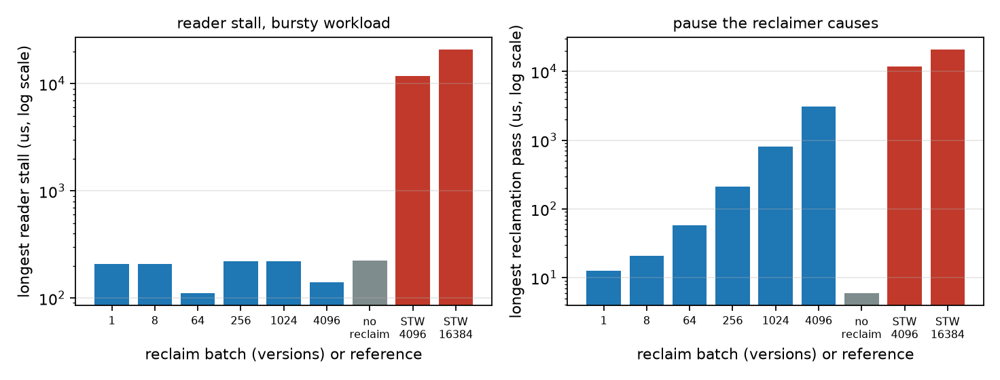

## 0. How the numbers were taken, and two traps we fell into

All runs are on one i9-13900K server, pinned with `taskset` to logical CPUs 0 to 15 (the 8 performance cores with their hyperthreads), CPU governor `performance`, the deep idle states (C2, C3) switched off, 5 s of reads, one background writer at 50,000 puts/s, and the **median of 3 runs** (the individual runs are listed in the tables). Before every group of runs a script checks that those CPUs are idle. The 100,000-trade table, the 80% hot / 20% random access pattern and the per-call timing are the provided generator's. There is no durability anywhere in Parts A to D.

D.1 uses the provided generator exactly as the assignment asks. D.2 and D.3 need numbers the generator does not report (the longest single stall, per-join latency), so they use our own harness, `bench.cpp`, which reads the store the same way but keeps a histogram per thread instead of a vector of samples. Its percentiles are within 1.6% of exact and its maximum is exact.

**Trap 1: where the store object sits in memory.** In Part A the same lock binary measured anywhere from 8M to 26M reads/s depending on nothing but the size of an unrelated environment variable. Part A's report has the evidence. Every store now has its lock, or its version pointer, alone on a cache line, and the numbers below come from those builds.

**Trap 2: the provided generator itself.** Its per-reader latency vectors sit side by side in one array, so every `push_back` from a different thread writes the same cache line. We checked by padding each vector to its own line in a copy of the generator and changing nothing else (`experiments/padded_generator.sh`):

| store (readers) | original generator | padded copy |
|---|---|---|
| global_lock (4) | 17.7M | 24.9M |
| rwlock (4) | 20.9M | 23.3M |
| rcu (4) | 41.2M | 58.1M |
| rcu (8) | 75.9M | **109.8M** |

So the generator's own bookkeeping costs the RCU store about **30% of its 8-reader throughput**. We still report the unmodified generator for D.1, as asked, and we also report the same four stores in our harness, which does not have this problem.

## D.1 Point-query throughput and the 100k target

The first table is the provided generator, default parameters. `single_thread` cannot run with a writer (it has no synchronisation), so it appears with one reader as the genuine single-thread case and, for reference, with more read-only readers and no writer: the ceiling an unsynchronised store reaches when nothing writes.

| store | readers | reads/s (M) | p50 (us) | p99 (us) | p999 (us) | the 3 runs (M) |
|---|---|---|---|---|---|---|
| single_thread, no writer | 1 | 19.1 | 0.018 | 0.056 | 0.152 | 19.1, 19.1, 19.2 |
| | 8 | 92.5 | 0.018 | 0.057 | 0.088 | 93.0, 91.1, 92.5 |
| global_lock | 1 | 17.1 | 0.023 | 0.062 | 0.258 | 17.1, 17.1, 17.1 |
| | 2 | 21.5 | 0.051 | 0.372 | 0.639 | 21.2, 21.7, 21.5 |
| | 4 | 21.0 | 0.075 | 1.115 | 2.449 | 21.0, 20.6, 24.1 |
| | 8 | 12.2 | 0.095 | 4.136 | 6.477 | 12.2, 12.1, 13.4 |
| rwlock | 1 | 17.0 | 0.024 | 0.063 | 0.302 | 17.0, 17.0, 17.0 |
| | 2 | 24.8 | 0.050 | 0.115 | 0.470 | 24.9, 24.8, 24.8 |
| | 4 | 21.8 | 0.106 | 0.528 | 3.142 | 21.8, 20.9, 22.7 |
| | 8 | 20.8 | 0.232 | 3.602 | 4.826 | 20.8, 24.0, 20.5 |
| **rcu (Part B)** | 1 | 14.8 | 0.034 | 0.073 | 0.169 | 14.9, 14.8, 14.8 |
| | 2 | 23.6 | 0.034 | 0.081 | 0.178 | 23.6, 29.4, 23.4 |
| | 4 | 42.2 | 0.034 | 0.089 | 0.217 | 36.7, 42.2, 43.6 |
| | 8 | **75.2** | 0.037 | 0.143 | 0.263 | 75.2, 73.6, 78.1 |

The same stores in the histogram harness (single-thread has no writer; the others have the 50,000 puts/s writer). The extra single-thread row is the faithful "single thread with a background writer": one thread serves the reads and also performs the 50,000 puts/s itself, as a single-threaded server would. It reaches 19.9M reads/s against 21.6M without writes, and the puts show up in the tail (p999 of 992 ns against 63 ns). The RCU store here is the Part C one, the final store:

| store | readers | reads/s (M) | p50 (ns) | p99 (ns) | p999 (ns) | longest call (us) |
|---|---|---|---|---|---|---|
| single_thread, no writer | 1 / 8 | 21.6 / 166.8 | 18 | 47 | 63 | 16 / 221 |
| single_thread, one thread doing the reads **and** 50,000 puts/s | 1 | 19.9 | 27 | 70 | 992 | 35 |
| global_lock | 1 | 19.1 | 23 | 53 | 256 | 17 |
| | 2 | 23.2 | 50 | 348 | 592 | 111 |
| | 4 | 19.6 | 85 | 1,344 | 2,720 | 362 |
| | 8 | 12.4 | 112 | 4,000 | 6,272 | 779 |
| rwlock | 1 | 19.0 | 23 | 54 | 272 | 97 |
| | 2 | 26.1 | 50 | 112 | 468 | 46 |
| | 4 | 23.0 | 113 | 536 | 3,008 | 309 |
| | 8 | 23.4 | 252 | 2,176 | 4,608 | 1,578 |
| **rcu** | 1 | 14.7 | 35 | 170 | 292 | 64 |
| | 2 | 29.5 | 35 | 166 | 264 | 74 |
| | 4 | 59.0 | 36 | 166 | 264 | 74 |
| | 8 | **112.3** | 37 | 168 | 284 | 222 |

**Where the lock-based stores stop scaling.** Taking "stops scaling" as the reader count after which doubling the readers adds under 10%: **global_lock stops at 2 readers** (21.5M, then 21.0M at 4 and 12.2M at 8), and **rwlock stops at 2 readers** (24.8M, then 21.8M and 20.8M). The harness agrees: both peak at 2 readers and never get back to that rate. Both then get slower as readers are added. Their tails explode too: at 8 readers p999 is 6.5 us and 4.8 us for the locks against 0.26 us for RCU, **25 times and 18 times worse**.

**Does RCU sustain 100,000+ reads/s at 8 readers? Yes, by a factor of about 750.** It does **75.2M reads/s in the provided generator and 112M in our harness**, with p999 of 0.26 us. It keeps scaling to 8 readers: 7.6x its 1-reader rate in the harness, against 7.7x for the unsynchronised ceiling. Since the target is met there is no shortfall to explain, but two honest points remain.

*RCU is slower than a mutex with a single reader* (14.8M against 17.1M in the generator, 14.7M against 19.1M in the harness). Every read announces itself with a locked instruction (the epoch `exchange`) and walks a trie, where the Part A table is one probe. RCU wins by scaling, not by single-thread speed. From 2 readers up it is ahead.

*The remaining gap to the unsynchronised ceiling* (75M against 92M in the generator, 112M against 167M in the harness) is the RCU read path plus its copy-on-write writer. The flame graph (`results/profile/rcu_r8.svg`) shows where the generator-based run spends its time at 8 readers:

| share of samples, rcu, 8 readers (generator) | |
|---|---|
| the generator's latency vector (`push_back`, page faults) | 29% |
| the generator's clock reads | 32% |
| the generator's random numbers | 7.7% |
| the store's `get` (trie walk, copy-out) | 14.6% |
| the store's epoch announcement (`exchange`) | 6.3% |

About **69% of the time is the measurement, not the store** (the first three rows), and the store itself, announcement included, is about 21%. That agrees with the padded-generator experiment above. The RCU-specific cost is the epoch announcement, 6.3% at 8 readers against 2.4% at 1 reader. That `exchange` is a locked instruction, which we think has to wait for the reader's earlier stores (the vector appends) to drain; we did not test that.

## D.2 Reclamation-batch tuning

8 readers; the RCU store; the longest stall is the slowest single `get` any reader saw in a 5 s run. Two scenarios, because short reads never fall behind and so give reclamation almost nothing to do:

- **steady**: the D.1 setup, writer at 50,000 puts/s.
- **bursty**: writer at 300,000 puts/s, and a thread pins a snapshot for 50 ms of every 100 ms, like a join in progress. About 15,000 versions pile up behind it and must be drained afterwards.

Two references. **No reclamation** never frees. **Naive stop-the-world** parks every reader at an operation boundary once T versions are waiting, frees the whole list at once, and lets them go. It uses an unbounded `reclaim_all()` and a gate in the harness.

*Bursty scenario, median of 3 runs (`results/d2.txt`):*

| setting | reads/s (M) | longest reader stall (us) | worst of 3 runs (us) | calls over 100 us | longest reclaim pass (us) | peak memory (MB) |
|---|---|---|---|---|---|---|
| batch 1 | 98.1 | 207 | 2,882 | 5 | 12 | 75 |
| batch 8 | 99.3 | 208 | 417 | 3 | 21 | 119 |
| batch 64 | 99.7 | 111 | 219 | 3 | 57 | 119 |
| batch 256 | 100.1 | 221 | 223 | 10 | 211 | 119 |
| batch 1024 | 99.9 | 221 | 222 | 4 | 803 | 119 |
| batch 4096 | 99.6 | 141 | 381 | 6 | 3,083 | 119 |
| **no reclamation** | 97.7 | 223 | 3,638 | 5 | 6 | **3,180** |
| **naive stop-the-world, T=4096** | 79.5 | **11,852** | 12,209 | 1,730 | 11,849 | 128 |
| **naive stop-the-world, T=16384** | 76.3 | **20,876** | 20,877 | 603 | 20,873 | 158 |

*Steady scenario (writer 50,000/s, nothing pinned):* batches 8, 64, 256 and 1024 give 114 to 115M reads/s and a backlog of at most 27 versions; no reclamation gives 112.0M and grows to 566 MB (against 44 MB); stop-the-world with T=4096 gives 109.5M and a 2.45 ms stall.

**What the batch size trades.** The hypothesis was "a bigger batch gives higher throughput but a longer worst-case stall". Our data says something more specific.

- **Throughput does not depend on the batch.** From batch 8 to 4096, bursty throughput stays between 99.3M and 100.1M, which is inside the run-to-run noise. Even with reclamation off the loss is only 2%.
- **The longest reader stall does not depend on the batch either.** It sits between about 110 and 220 us for every bounded setting, which is **the machine's noise floor**: the unsynchronised store with no writer at all shows 221 us at 8 readers. In this design a reader never waits for a reclamation pass; it only ever competes with it for cache and memory bandwidth.
- **What the batch does control is how long one pass runs, and that is linear in it:** about 0.75 us per version, from 12 us at batch 1 to 57 us at 64, 803 us at 1024 and 3.1 ms at 4096. That pass runs on the writer thread, so the batch is a direct dial on **how long the writer can be tied up in a single call**, and it is the number the "bounded pause" promise is about. The backlog peak (15,021 versions) is set by how long the snapshot is held, not by the batch.
- **A batch of 1 cannot catch up.** The writer retires one version per put and frees at most one, so a backlog built behind a held snapshot cannot shrink. Its peak memory was 75 MB against 119 MB for every larger batch; we did not investigate why the larger batches peak higher.
- **Not reclaiming is cheap in speed and ruinous in memory:** 3.2 GB after 5 s of the bursty writer.

**Choice.** Pick the largest batch whose pass you can afford on the writer thread. 64 to 256 keeps a pass between 57 and 211 us and drains a backlog quickly enough. Our default is 64.

**Bounded against stop-the-world.** In the bursty scenario the readers' worst stall is **11.9 ms with the stop-the-world sweep at T=4096 and 20.9 ms at T=16384, against about 0.2 ms for the bounded batches: roughly 55 to 95 times worse**. The stop-the-world pause grows with the list it has to free (about 0.6 us per version), and it also costs **20% to 24% of read throughput** (79.5M and 76.3M against 99 to 100M), because every freeze parks all 8 readers. In the steady scenario, where little is waiting, the stop-the-world stall is smaller but still 2.45 ms, about 11 times the bounded one.

## D.3 Join and multi-key write benchmarking

**Join (index-nested-loop, 8 readers, `join.h`).** Each join takes one snapshot, enumerates the first N trade keys with `keys()`, reads each trade, probes the symbol index of the 50-row instrument table, and fetches the matching row. Median of 3 runs, which agreed to within 0.2%:

| outer rows per join | writer | joins/s | outer rows/s (k) | p50 (us) | p99 (us) | p999 (us) | longest (us) |
|---|---|---|---|---|---|---|---|
| 1,000 | on, 50,000 puts/s | 202,259 | 202,259 | 37.9 | 51.7 | 62.0 | 1,703 |
| 1,000 | paused | 184,501 | 184,501 | 42.5 | 49.7 | 65.5 | 256 |
| 100,000 | on | 589 | 58,879 | 13,369 | 14,549 | 15,204 | 15,318 |
| 100,000 | paused | 590 | 59,039 | 13,500 | 13,894 | 15,073 | 15,285 |

**The concurrent writer costs a running join nothing we can measure.** The full-table join (100,000 outer rows) is 589 against 590 joins/s, with p99 within 5%. The 1,000-row join was about 10% *faster* with the writer on, and repeatably so (all three runs of each agree to 0.2%). We checked whether it was thread placement: with 4 readers the writer-on run is still 5% faster, and 10% faster when the readers are pinned to separate physical cores (`experiments/join_placement.sh`). So it is not placement. We have no verified explanation. Our guess, which we did not test, is that the writer's copy-on-write allocates the nodes it touches back to back, so the rows a join keeps re-reading end up closer together in memory than they were after the initial load. The honest summary is "no cost, and a small unexplained benefit". The writer does show up once, in the 1,703 us longest join, against 256 us when paused.

**Multi-key transaction commit throughput, writer flat out** (RCU store against the in-place rwlock store):

| store | readers running | keys per transaction | commits/s (k) | keys/s (k) | commit p50 (us) | commit p99 (us) |
|---|---|---|---|---|---|---|
| rcu | 0 | 1 / 4 / 16 | 3,511 / 1,614 / 357 | 3,511 / 6,457 / 5,716 | 0.24 / 0.58 / 2.66 | 0.51 / 1.54 / 4.22 |
| rcu | 8 | 1 / 4 / 16 | 1,078 / 549 / 157 | 1,078 / 2,196 / 2,511 | 0.89 / 1.70 / 6.14 | 1.33 / 3.20 / 10.2 |
| rwlock | 0 | 1 / 4 / 16 | 12,533 / 4,610 / 1,279 | 12,533 / 18,442 / 20,467 | 0.06 / 0.17 / 0.66 | 0.10 / 1.09 / 1.65 |
| rwlock | 8 | 1 / 4 / 16 | 181 / 45 / 12 | 181 / 179 / 192 | 4.99 / 19.7 / 74.8 | 12.5 / 42.5 / 153.6 |

Two readings. With nobody reading, batching helps the RCU store: keys per second rises from 3.5M (1 key) to 6.5M (4 keys) and 5.7M (16 keys), because the copied path nodes are shared between keys in one commit. But **an in-place store is faster for writes when nothing reads** (12.5M to 20M keys/s). **Once 8 readers are running the picture reverses:** RCU commits 6x to 13x more per second (1,078k against 181k with 1 key; 157k against 12k with 16 keys), its commit p99 stays at 1.3 to 10 us where the lock store's goes to 12 to 154 us, and the readers it serves run at **82 to 95M reads/s against 13 to 14M**. The lock store's writer starves behind its readers and the readers stall behind its writer, which is exactly what the RCU design removes.

**Bounded reclamation against stop-the-world** (from D.2, bursty): worst reader pause **about 0.2 ms bounded against 11.9 to 20.9 ms stop-the-world, roughly 55 to 95 times lower**.

**When copy-on-write helps little or hurts.** One transaction of N keys on the loaded 100,000-row table (median of 7, `results/d3.txt`):

| keys in the transaction | rcu | rcu per key | extra heap while it lives | rwlock (in place) | rwlock per key |
|---|---|---|---|---|---|
| 1 | 0.2 us | 168 ns | 0 | 0.1 us | 104 ns |
| 256 | 0.020 ms | 79 ns | 0.28 MB | 0.010 ms | 40 ns |
| 4,096 | 0.43 ms | 104 ns | 3.5 MB | 0.14 ms | 35 ns |
| 65,536 | 11.2 ms | 172 ns | 32.6 MB | 2.5 ms | 38 ns |
| 100,000 | 15.9 ms | 159 ns | **47.7 MB** | 4.1 ms | 41 ns |

COW helps little or hurts when **a single write touches a large fraction of the table.** A transaction that rewrites 65,536 to 100,000 of the 100,000 rows must copy nearly every leaf and inner node, so it is **4x slower than updating in place** (15.9 ms against 4.1 ms) and it needs **48 MB of extra heap, about as much as the table itself** (40 MB), until the old version is reclaimed: the store briefly holds two copies. A bulk reload or a table-wide recalculation is exactly that workload. The per-key cost also rises from about 80 ns to 160 to 170 ns as the transaction grows; we did not isolate why (the number of nodes allocated and later freed per key is the obvious suspect). The same mechanism makes a **long-held snapshot expensive** (1.4 million retired versions in 3 s of heavy writing in the Part C test). And for tiny writes, every write costs 1.6 to 4 times the in-place price per key (168 ns against 104 ns for a single key, 159 against 41 for 100,000), a price worth paying only because readers are never blocked.

## Raw data

`results/d1.csv` (generator), `results/d1b.txt` (harness), `results/d1_single_inline.txt` (single thread with its own writer), `results/d1_time.txt` (CPU time and context switches of each D.1 run), `results/d2.txt` and `results/hist/*.csv` (latency histograms: `d1_*` for D.1 at 8 readers, `bursty_*` for D.2, `d3_join1000_*` for the D.3 joins; each row is a bucket's lower bound in ns and its count), `results/d3.txt`, `results/profile/` (perf stat, folded stacks and flame graphs for RCU at 1 and 8 readers; the same for the two lock stores at 1, 2, 4 and 8 readers is in `../partA/results/profile/`), `results/padded_generator.txt`, `results/envsweep.txt`, `results/quiet.log` (the idle-CPU check before each group). Scripts: `d1.sh`, `d1b.sh`, `d2.sh`, `d3.sh`, `profile_rcu.sh`, `bench.cpp`; summaries by `tools/summarize_d.py`, charts by `tools/make_charts.py`.
